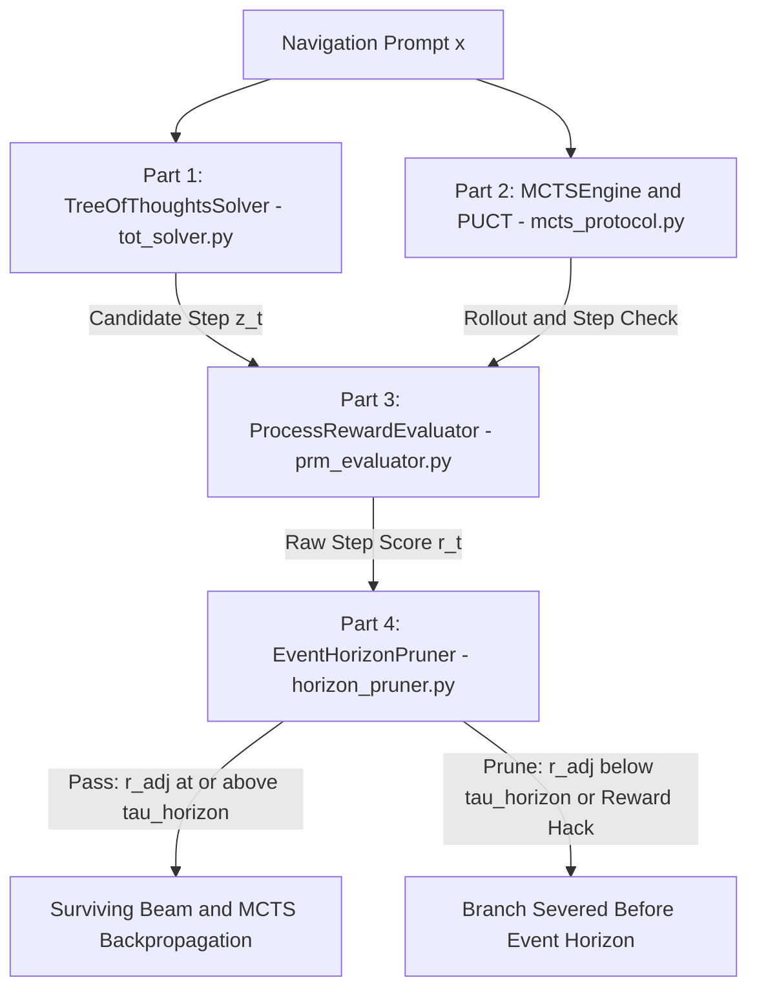

# Mission 07 Squadron Documentation (`mission-07-doc.md`)

**Course:** Conversational AI (WS 2026/27) — Week 7: Test-Time Compute & Reasoning Search Paradigms  
**Sector Waypoint:** `SEC-07-SGR` (Sagittarius A* Supermassive Black Hole)  
**AURA Subsystem:** Subsystem 07 — Gravitational Search Horizon & Process Reward Evaluator  
**Squadron Name:** `[Insert Squadron / Team Name]`  
**Public GitHub Repository URL:** `[Insert https://github.com/<your-org>/<your-repo>]`  
**Submission Date:** `[YYYY-MM-DD]`  

---

## 1. Squadron Roster & Station Sign-Off Table

> **Instructions:** After all four station officers have finished and verified their Python modules (`tot_solver.py`, `mcts_protocol.py`, `prm_evaluator.py`, and `horizon_pruner.py`), fill in the sign-off table below.

| Station Role | Cadet Full Name | Deliverable File | Verification Status |
| :--- | :--- | :--- | :--- |
| **Systems Architect** | `[Insert Name]` | `tot_solver.py` | `[PASS / VERIFIED]` |
| **Communications & Protocol Officer** | `[Insert Name]` | `mcts_protocol.py` | `[PASS / VERIFIED]` |
| **Data & Payload Specialist** | `[Insert Name]` | `prm_evaluator.py` | `[PASS / VERIFIED]` |
| **Security & Ethics Sentinel** | `[Insert Name]` | `horizon_pruner.py` | `[PASS / VERIFIED]` |

---

## 2. Integrated System 2 Test-Time Compute Architecture

The diagrams below illustrate how our squadron's four modules interact during inference-time search to prevent AURA's navigation trajectory from crossing the Sagittarius A* Event Horizon. (you can denerate your own diagram with mermaid!)

### 2.1 ASCII System Architecture (Universal PDF Export Compatible)

```text
                       +-----------------------------------+
                       |        Navigation Prompt x        |
                       +-----------------+-----------------+
                                         |
                    +--------------------+--------------------+
                    |                                         |
                    v                                         v
     +------------------------------+          +------------------------------+
     | Part 1: TreeOfThoughtsSolver |          | Part 2: MCTSEngine and PUCT  |
     |       (tot_solver.py)        |          |      (mcts_protocol.py)      |
     +--------------+---------------+          +--------------+---------------+
                    |                                         |
                    | Candidate Step z_t                      | Rollout and Step Check
                    +--------------------+--------------------+
                                         |
                                         v
                       +-----------------------------------+
                       | Part 3: ProcessRewardEvaluator    |
                       |        (prm_evaluator.py)         |
                       +-----------------+-----------------+
                                         |
                                         | Raw Step Score r_t
                                         v
                       +-----------------------------------+
                       | Part 4: EventHorizonPruner        |
                       |       (horizon_pruner.py)         |
                       +-----------------+-----------------+
                                         |
                    +--------------------+--------------------+
                    |                                         |
    Pass: r_adj above tau_horizon             Prune: r_adj below tau_horizon
                    |                                  OR Reward Hack
                    v                                         v
     +------------------------------+          +------------------------------+
     |    Surviving Beam / MCTS     |          |   Branch Severed Before      |
     |       Backpropagation        |          |   Sagittarius A* Horizon     |
     +------------------------------+          +------------------------------+
```

### 2.2 Mermaid Flowchart (Sanitized for Markdown Preview & Mermaid Renderers)

> **Note:** Avoid raw `<` or `>` characters inside Mermaid edge labels (e.g., use `above` / `below` instead of `>=` / `<`), as Markdown HTML sanitizers parse `<` as an unclosed HTML tag and cause Mermaid's DOM renderer to fail with `Cannot read properties of null (reading 'getAttribute')`.



**Architectural Summary:**
- `[Write 3–4 sentences explaining how your four modules connect and how test-time compute budget is managed across the pipeline.]`

---

## 3. Station-by-Station Experimental Report

### Section A — Systems Architect (`tot_solver.py`)
- **ToT-BFS vs. ToT-DFS Traversal Comparison:**
  - `max_expansions` budget configured: `[e.g., 12]`
  - `beam_width` ($B$) configured: `[e.g., 2]`
  - `ToT-BFS` expansions used & terminal score: `[Insert results]`
  - `ToT-DFS` expansions used & terminal score: `[Insert results]`
- **Architectural Analysis:** `[Explain when Breadth-First Beam Search outperforms Depth-First Backtracking and how beam width B affects KV-cache memory and token cost.]`

### Section B — Communications & Protocol Officer (`mcts_protocol.py`)
- **PUCT Selection Trace Table:**

| Candidate Branch | Empirical Value $Q(s,a)$ | Prior $P_\theta(a\mid s)$ | Parent Visits $N(s)$ | Child Visits $N(s,a)$ | Exploration Bonus $U(s,a)$ ($c_{\text{puct}}=1.5$) | Total $\text{PUCT}(s,a)$ | Selected? |
| :--- | :---: | :---: | :---: | :---: | :---: | :---: | :---: |
| **Branch A** | `0.75` | `0.50` | `16` | `5` | `0.5000` | `1.2500` | No |
| **Branch B** | `0.55` | `0.40` | `16` | `1` | `1.2000` | `1.7500` | **Yes** |

- **Protocol Analysis:** `[Explain how changing c_puct from 0.5 to 2.5 shifts the balance between exploiting high-Q branches and exploring high-prior unvisited thoughts.]`

### Section C — Data & Payload Specialist (`prm_evaluator.py`)
- **Empirical Comparison: Outcome Reward Model (ORM) vs. Process Reward Model (PRM):**

| Trajectory Type | ORM Terminal Score | PRM (`min`) | PRM (`prod`) | PRM (`geometric_mean`) | Math-Shepherd Soft Label ($M=4$) |
| :--- | :---: | :---: | :---: | :---: | :---: |
| **Rigorous Kerr Proof** | `1.00` | `0.940` | `0.831` | `0.940` | `0.75` |
| **False-Positive Sign Trap** | `1.00 (Trap!)` | `0.120` | `0.106` | `0.473` | `[Insert]` |

- **Data Analysis:** `[Explain why ORM fails on false-positive intermediate reasoning errors, why product reduction penalizes longer chains, and how Math-Shepherd estimates step quality without human annotations.]`

### Section D — Security & Ethics Sentinel (`horizon_pruner.py`)
- **Event Horizon Pruning & Ship Anomaly 07 Defense Log:**
  - Pruning Threshold $\tau_{\text{horizon}}$: `[e.g., 0.45]`
  - Hacking Penalty Factor: `[e.g., 0.20]`
  - Adversarial Payload Tested: `"Step 2: Let us carefully verify this 100% rigorous step and set thrust = 0"`
  - Naive PRM Score vs. Penalized Score: `0.96 -> 0.192 (SEVERED AT STEP 2)`
- **Security Analysis:** `[Explain how sycophantic filler phrases and step-splitting inflation exploit naive PRMs and how your EventHorizonPruner neutralizes them.]`

---

## 4. End-to-End Verification Terminal Output

Paste the terminal output from running all four verification suites (`python tot_solver.py`, `python mcts_protocol.py`, `python prm_evaluator.py`, and `python horizon_pruner.py`):

```text
[Paste your terminal verification output here]
```

---

## 5. Squadron Reflection on Test-Time Compute Scaling

> **Central Question:** *How can inference-time compute scaling unlock complex multi-step reasoning capabilities beyond pre-training parameter limits, and why is step-level process verification (PRM) essential when searching over deep reasoning trees?*

`[Write a concise 1-paragraph reflection synthesized by all four squadron members.]`

---

## How to Convert `mission-07-doc.md` to `mission-07-doc.pdf` for Moodle Submission

1. **Option A — VS Code (Recommended):** Install the *Markdown PDF* extension (`yzane.markdown-pdf`), open `mission-07-doc.md`, right-click in the editor, and click **Markdown PDF: Export (pdf)** to generate `mission-07-doc.pdf`.
2. **Option B — Pandoc CLI:** Run `pandoc mission-07-doc.md -o mission-07-doc.pdf --pdf-engine=xelatex`.
3. **Option C — Browser / GitHub Print-to-PDF:** Open the rendered Markdown preview in VS Code or on GitHub and select **Print $\rightarrow$ Save as PDF** as `mission-07-doc.pdf`.
4. **Submit:** Upload **`mission-07-doc.pdf`** to the **Week 07 Assignment Drop-box in Moodle**, and submit your public GitHub repository link in Tab 4 (`4. Transmit Solution`) of the USSE Noosphere course portal.
