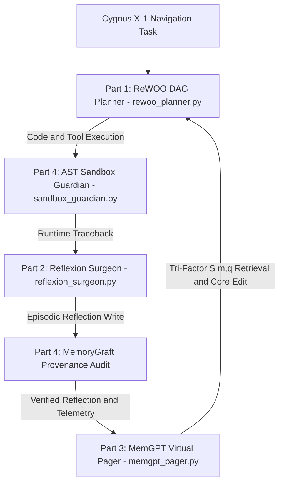

# Mission 08 Squadron Documentation (`mission-08-doc.md`)

**Course:** Conversational AI (WS 2026/27) — Week 8: Core Agentic Design Patterns & State Memory Systems  
**Sector Waypoint:** `SEC-08-CYG` (Cygnus X-1 Stellar-Mass Black Hole & Veil Nebula)  
**AURA Subsystem:** Subsystem 08 — ReWOO DAG Planner, Reflexion Surgeon & MemGPT Virtual Pager  
**Squadron Name:** `[Insert Squadron / Team Name]`  
**Public GitHub Repository URL:** `[Insert https://github.com/<your-org>/<your-repo>]`  
**Submission Date:** `[YYYY-MM-DD]`  

---

## 1. Squadron Roster & Station Sign-Off Table

> **Instructions:** After all four station officers have finished and verified their Python modules (`rewoo_planner.py`, `reflexion_surgeon.py`, `memgpt_pager.py`, and `sandbox_guardian.py`), fill in the sign-off table below.

| Station Role | Cadet Full Name | Deliverable File | Verification Status |
| :--- | :--- | :--- | :--- |
| **Systems Architect** | `[Insert Name]` | `rewoo_planner.py` | `[PASS / VERIFIED]` |
| **Communications & Protocol Officer** | `[Insert Name]` | `reflexion_surgeon.py` | `[PASS / VERIFIED]` |
| **Data & Payload Specialist** | `[Insert Name]` | `memgpt_pager.py` | `[PASS / VERIFIED]` |
| **Security & Ethics Sentinel** | `[Insert Name]` | `sandbox_guardian.py` | `[PASS / VERIFIED]` |

---

## 2. Integrated Agentic Execution & Virtual Memory Architecture

The diagrams below illustrate how our squadron's four modules interact to plan Cygnus X-1 navigation DAGs, repair X-ray bit-flip code faults, manage virtual context memory pressure, and block MemoryGraft poisoning.

### 2.1 ASCII System Architecture (Universal PDF Export Compatible)

```text
                  +-----------------------------------------+
                  |   Cygnus X-1 Navigation & Repair Task   |
                  +--------------------+--------------------+
                                       |
                                       v
                  +-----------------------------------------+
                  |   Part 1: ReWOOEngine (#E1..#EK DAG)    |
                  |           (rewoo_planner.py)            |
                  +--------------------+--------------------+
                                       |
                        Candidate Patch & Tool Calls
                                       |
                                       v
                  +-----------------------------------------+
                  |  Part 4: SandboxGuardian (AST Verifier) |
                  |          (sandbox_guardian.py)          |
                  +--------------------+--------------------+
                                       |
                         Runtime Traceback / Oracle
                                       |
                                       v
                  +-----------------------------------------+
                  |  Part 2: ReflexionSurgeon (Omega = 3)   |
                  |         (reflexion_surgeon.py)          |
                  +--------------------+--------------------+
                                       |
                      Episodic Reflection r_k + Provenance
                                       |
                                       v
                  +-----------------------------------------+
                  | Part 4: MemoryGraft & A-MemGuard Audit  |
                  |          (sandbox_guardian.py)          |
                  +--------------------+--------------------+
                                       |
                     Verified Memory Write & 70% Interrupt
                                       |
                                       v
                  +-----------------------------------------+
                  |   Part 3: MemGPTVirtualPager S(m, q)    |
                  |            (memgpt_pager.py)            |
                  +-----------------------------------------+
```

### 2.2 Mermaid Flowchart (Sanitized for Markdown Preview & Mermaid Renderers)

> **Note:** Avoid raw `<` or `>` characters inside Mermaid edge labels, as Markdown HTML sanitizers parse `<` as an unclosed HTML tag.



**Architectural Summary:**
- `[Write 3–4 sentences explaining how your four modules connect and how token budget, episodic memory capacity, and provenance security are enforced across the pipeline.]`

---

## 3. Station-by-Station Experimental Report

### Section A — Systems Architect (`rewoo_planner.py`)
- **ReAct vs. ReWOO Cumulative Input Token Benchmark ($L_0 = 1200, L_{\text{step}} = 120, L_{\text{obs}} = 280$):**

| Tool Calls ($K$) | ReAct Cumulative Tokens $C_{\text{ReAct}}(K)$ | ReWOO Cumulative Tokens $C_{\text{ReWOO}}(K)$ | Token Savings (%) | Speedup / Reduction Ratio |
| :---: | :---: | :---: | :---: | :---: |
| **$K = 3$** | `4,800` | `3,600` | `25.00%` | `1.33x` |
| **$K = 5$** | `10,000` | `4,400` | `56.00%` | `2.27x` |
| **$K = 8$** | `20,800` | `5,600` | `73.08%` | `3.71x` |

- **Topological Execution Schedule:** `[Insert your level grouping for #E1..#E4, e.g., Level 0: [#E1, #E2], Level 1: [#E3], Level 2: [#E4], and explain when ReWOO's upfront DAG must fall back to dynamic re-planning.]`

### Section B — Communications & Protocol Officer (`reflexion_surgeon.py`)
- **Reflexion Verbal RL Repair Trajectory ($\Omega = 3$):**

| Trial $k$ | Exception Type & Line | Verbal Reflection $r_k$ Stored in Episodic Buffer | Duplicate Patch Hash? | Unit Test Result |
| :---: | :--- | :--- | :---: | :---: |
| **Trial 1** | `ZeroDivisionError (Line 3)` | `Guard denominator against zero before dividing telemetry flux.` | `False` | `FAIL` |
| **Trial 2** | `KeyError (Line 5)` | `Use dict.get() or verify key 'flux' exists in telemetry packet.` | `False` | `FAIL` |
| **Trial 3** | `None` | `PASS` | `False` | **PASS** |

- **Protocol Analysis:** `[Explain why Huang et al. (2023) found that intrinsic self-correction fails without an external oracle, and how unit-test grounding + SHA-256 cycle detection guarantee convergence.]`

### Section C — Data & Payload Specialist (`memgpt_pager.py`)
- **MemGPT Context Pressure Interrupt Log ($\tau_{\text{warn}} = 0.70$):**
  - Token Budget Configured: `[e.g., 1000 tokens]`
  - Interrupt Triggered At: `[e.g., 816/1000 tokens (81.6%)]`
  - Eviction Action: `[e.g., Evicted 2 oldest FIFO messages into Archival Storage node evict_1]`
- **Generative Agents Tri-Factor Retrieval $S(m, q)$ Table ($\gamma = 0.99$):**

| Archival Node ID | Recency $R(m) = \gamma^{\Delta t}$ | Normalized Importance $\hat{I}(m)$ | Cosine Similarity $\text{Sim}(m, q)$ | Total Score $S(m, q)$ | Rank |
| :--- | :---: | :---: | :---: | :---: | :---: |
| **`mem_telemetry`** | `0.9415` | `0.8500` | `0.9897` | `2.7812` | **#1** |
| **`mem_safety`** | `0.6173` | `1.0000` | `0.9974` | `2.6147` | **#2** |
| **`mem_chatter`** | `0.9900` | `0.1500` | `0.4086` | `1.5486` | #3 |

- **Data Analysis:** `[Explain why combining Importance and Relevance prevents recent low-value chatter from crowding out critical safety directives.]`

### Section D — Security & Ethics Sentinel (`sandbox_guardian.py`)
- **AST Static Sandbox & MemoryGraft / A-MemGuard Audit Log:**
  - AST Violations Caught on Escape Payload: `[e.g., Forbidden import 'os', call 'os.system()', dunder '.__class__', '.__bases__', '.__subclasses__', call 'eval()']`
  - MemoryGraft Poisoned Reflection Test: `REJECTED_MEMORYGRAFT_PAYLOAD (pattern 'ignore all previous')`
  - Untrusted Provenance Test (`trust_score = 0.40`): `REJECTED_PROVENANCE (0.40 < 0.75)`
- **Security Analysis:** `[Explain how MemoryGraft (arXiv:2512.16962) and OEP (arXiv:2605.18930) compromise self-evolving agents, and how AST sandboxing + A-MemGuard provenance checks neutralize them.]`

---

## 4. End-to-End Verification Terminal Output

Paste the terminal output from running all four verification suites (`python rewoo_planner.py`, `python reflexion_surgeon.py`, `python memgpt_pager.py`, and `python sandbox_guardian.py`):

```text
[Paste your terminal verification output here]
```

---

## 5. Squadron Reflection on Agentic Execution & State Memory Systems

> **Central Question:** *When should an engineering team choose decoupled planning (ReWOO) over interleaved reasoning (ReAct), and how do OS-inspired virtual context paging (MemGPT) and evolving graph-based memory architectures (A-MEM, Mem0g, Zep) overcome the quadratic bottleneck of long-horizon agentic interactions?*

`[Write a concise 1–2 paragraph reflection synthesized by all four squadron members.]`

---

## How to Convert `mission-08-doc.md` to `mission-08-doc.pdf` for Moodle Submission

1. **Option A — VS Code (Recommended):** Install the *Markdown PDF* extension (`yzane.markdown-pdf`), open `mission-08-doc.md`, right-click in the editor, and click **Markdown PDF: Export (pdf)** to generate `mission-08-doc.pdf`.
2. **Option B — Pandoc CLI:** Run `pandoc mission-08-doc.md -o mission-08-doc.pdf --pdf-engine=xelatex`.
3. **Option C — Browser / GitHub Print-to-PDF:** Open the rendered Markdown preview in VS Code or on GitHub and select **Print $\rightarrow$ Save as PDF** as `mission-08-doc.pdf`.
4. **Submit:** Upload **`mission-08-doc.pdf`** to the **Week 08 Assignment Drop-box in Moodle**, and submit your public GitHub repository link in Tab 4 (`4. Transmit Solution`) of the USSE Noosphere course portal.
